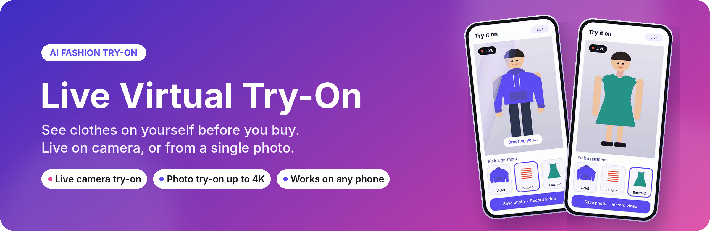
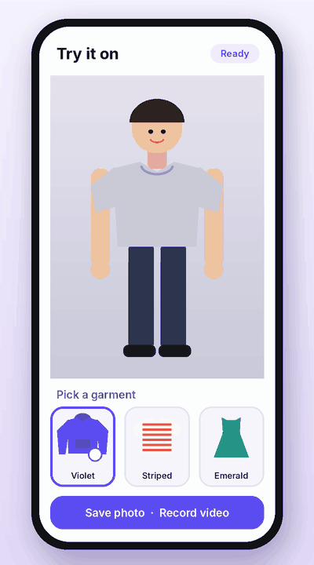
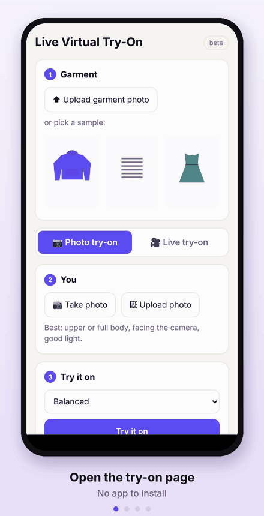
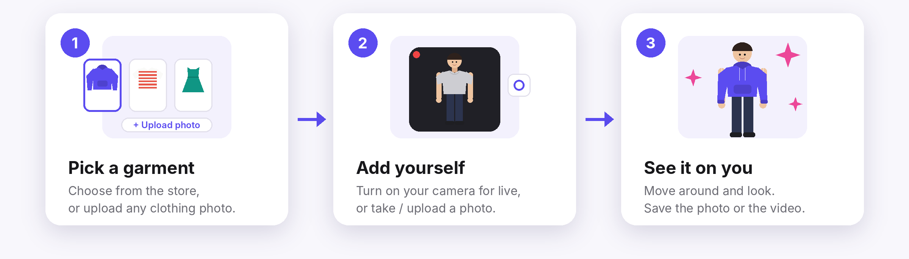
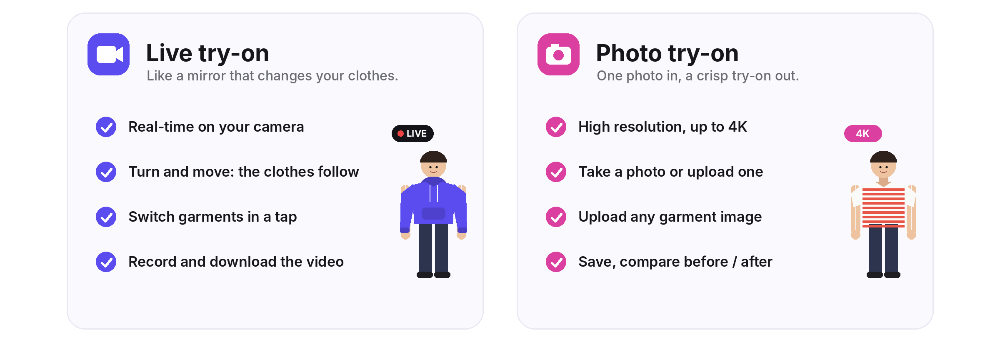
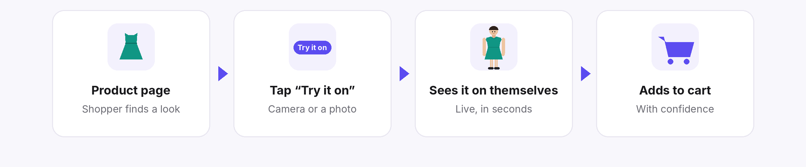

  

  <a href="https://live-virtual-try-on.brandzaha.com"><b>▶&nbsp; Try the live demo</b></a>
  &nbsp;·&nbsp; <a href="#-how-it-works">How it works</a>
  &nbsp;·&nbsp; <a href="#-features">Features</a>
  &nbsp;·&nbsp; <a href="#-for-online-stores">For stores</a>
  &nbsp;·&nbsp; <a href="#-privacy">Privacy</a>

  <b>See it on you before you buy it.</b> 
  Shoppers pick a garment and instantly see themselves wearing it, live on their camera like a mirror,
  or as a crisp photo. It runs in the browser on any phone or laptop, with nothing to install.

---

## 🎬 See it in action

<table>
  <tr>
    <td align="center" width="50%">
       
      <b>Tap a garment → wear it, live</b> Switch outfits in a tap. The clothes follow as you move.
    </td>
    <td align="center" width="50%">
       
      <b>The app on a phone</b> Pick a garment, add your photo, or go live.
    </td>
  </tr>
</table>

---

## 🧭 How it works

1. **Pick a garment.** Choose one from the store, or upload any clothing photo: a product shot or someone wearing it.
2. **Add yourself.** Turn on your camera for live try-on, or take or upload a photo.
3. **See it on you.** Move around, compare before and after, and save the photo or record a video.

---

## 🎥 Two ways to try

| | 🎥 **Live try-on** | 📷 **Photo try-on** |
|---|---|---|
| **Best for** | Seeing how it looks as you move and turn | A sharp picture to keep or share |
| **You need** | Your phone or laptop camera | One photo, from the camera or your gallery |
| **You get** | Real-time video, which you can record and download | A high-resolution image, up to 4K |
| **Switching garments** | Instant, no restart | Pick another and try again |

---

## ✨ Features

| Feature | What you get |
|---|---|
| 🎥 **Live camera try-on** | Like a mirror that changes your clothes. Front or back camera, with live preview. |
| 📷 **Photo try-on up to 4K** | Your face, hair and background stay exactly as they are; only the garment changes. |
| 👕 **Any garment** | Tops, jackets, bottoms and dresses. Pick from the catalog or upload a product photo. |
| 🤖 **Smart fit assistant** | AI checks that your photo shows a person and estimates men's or women's fit. You can change it in one tap. |
| 💾 **Save and share** | Download the try-on photo, compare before and after, or download the recorded live video. |
| 📱 **Works everywhere** | Runs in the browser on Android, iPhone and desktop, on Wi-Fi or mobile data. No app needed. |
| 🏷️ **Your brand** | White-label: your name, colours and domain. Shoppers only ever see your store. |
| 🔒 **Privacy first** | The camera runs only while you use it. Nothing is kept unless the shopper opts in. |

---

## 🛍️ For online stores

- **A "Try it on" button on every product page.** Shoppers see the fit and colour on themselves before they buy.
- **More confident buyers.** Seeing the garment on your own body answers "will this suit me?" on the spot.
- **Predictable costs.** Built-in daily limits per store and per visitor keep usage under control.
- **Fits your look.** Your logo, colours and domain. No third-party branding in front of your customers.

---

## 💡 Tips for the best result

| Tip | How |
|---|---|
| 🧍 **Framing** | Stand 1–2 m back with your upper body (or full body) in view, arms relaxed. |
| 💡 **Light** | Even, front-facing light. Avoid a bright window behind you. |
| 👕 **Garment photo** | Front-facing, with the whole garment visible. Product photos work best. |
| 📶 **Live on mobile** | A steady 4G or 5G connection gives the smoothest live view. |

---

## 🔒 Privacy

- Your camera and photos are used **only to create your try-on**.
- **Nothing is saved** unless you switch on *"Save my photos and videos to help improve the try-on"*. That's only for people aged 18 or older, and try-on works the same either way.
- If you did opt in, you can ask us to delete your photos and videos at any time.

---

## 🗺️ Status

| Part | Status |
|---|---|
| 🎥 Live try-on | ✅ Live |
| 📷 Photo try-on | ✅ Live |
| 🖼️ 4K photo results | 🧪 In testing |
| 🤖 Smart fit assistant | 🧪 In testing |
| 💾 Save photos and videos (with consent) | 🧪 In testing |

---

  <a href="https://live-virtual-try-on.brandzaha.com"><b>▶&nbsp; Try it now</b></a>  
  Made by <b>Brandzaha</b> &nbsp;·&nbsp; Team docs: <a href="docs/TECHNICAL.md">docs/TECHNICAL.md</a>

